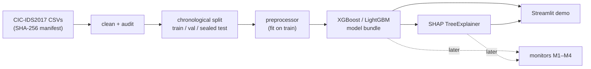

# EA-IDRS — Explanation-Aware Intrusion Detection and Response System

A flow-level network intrusion detection research system. It trains a gradient-boosted tree
classifier on CIC-IDS2017, explains its predictions with SHAP, and (in later phases) studies
whether **explanation-based drift monitoring warns earlier** than feature and score monitoring
when one attack class starts being missed.

B.Tech Project (CS401), Group DTU/CSE/BTP/GP050 · Guide: Dr. Yeshwant Singh, Dept. of CSE, DTU.

## Research question

> When does explanation-based drift monitoring give additional warning of
> attack-class-specific recall degradation under delayed labels?

We compare four monitors on identical replay windows: **M1** feature drift, **M2** prediction
score and predicted-class mix, **M3** = M1 + M2, and **M4** = M3 + class-conditional SHAP
attribution drift. The primary endpoint is the change in warning lead time of M4 over M3 at a
matched false-alarm budget. Monitors never see labels; a separate evaluator uses delayed labels.
Details: [`docs/research-roadmap.md`](docs/research-roadmap.md).

## Current status (6 Nov 2026)

| Area | Status |
|---|---|
| Engineering foundation (uv lockfile, CI, templates, docs) | Implemented, awaiting review |
| Data pipeline (manifest, cleaning, chronological split, audit) | Implemented and tested on **synthetic fixtures only** |
| CIC-IDS2017 download, audit, data card | Planned 8–10 Nov |
| XGBoost / LightGBM baselines (validation) | Planned 11–12 Nov |
| SHAP explanations | Planned 13 Nov |
| Streamlit prototype | Planned 14 Nov |
| Monitors M1–M4, delayed-label replay, evaluator | Phase 3–4 (Dec 2026 – Jan 2027) |
| FastAPI, SQLite, Docker simulation | Phase 5 (2027) |

No results are reported yet. Results appear here only after a recorded run produces them.
Plan and checklist: [`docs/minor-evaluation/`](docs/minor-evaluation/).

## Architecture



All logic lives in one Python library (`src/eaidrs/`) that experiments and apps import.
See [`docs/architecture.md`](docs/architecture.md) and the decision records in
[`docs/adr/`](docs/adr/).

> `frontend/`, `backend/` and `ml-service/` are **legacy scaffolding** from the first commit
> (React/Express templates). They are not part of the approved architecture and the root
> `compose.yaml` does not currently build. See ADR-0002.

## Tech stack

Python 3.12 · uv · pandas · NumPy · scikit-learn · XGBoost · LightGBM · SHAP · pydantic + YAML ·
Streamlit + Plotly (demo) · pytest · ruff · mypy · import-linter · GitHub Actions.
Later: FastAPI, SQLite (SQLAlchemy), Docker Compose.

## Installation

```bash
# 1. Install uv (Windows: winget install astral-sh.uv ; macOS/Linux: see docs.astral.sh/uv)
# 2. Clone and install exact locked versions
git clone https://github.com/guptaksht10/ea-idrs.git
cd ea-idrs
uv python install 3.12
uv sync --all-groups
# 3. Check everything works
uv run pytest
```

## Dataset setup

CIC-IDS2017 is never committed. Download instructions: [`data/README.md`](data/README.md).
Then:

```bash
# Once, by the person who downloads the files (commit data/MANIFEST.sha256 afterwards)
uv run eaidrs manifest create
# Everyone else, after copying the same files into data/raw/cicids2017/
uv run eaidrs manifest verify

# Audit: file inventory, data quality, class-by-day, and class-by-split for both split options
uv run eaidrs audit --split-config configs/split/grouped_by_day_label.yaml \
                    --split-config configs/split/global_by_day.yaml

# Write processed chronological splits (train/val; test goes to a sealed folder)
uv run eaidrs prepare --split-config configs/split/grouped_by_day_label.yaml
```

Each command writes a run folder under `runs/` with the config copy, git commit, data
manifest hash, environment and outputs. Optional path overrides are in `.env.example`.
The split strategy is still **proposed** (ADR-0008); the audit provides the evidence to choose.

## Training and SHAP demo

PENDING: commands are added when MODEL-01 (training) and APP-01 (Streamlit) are merged.

## Testing and quality checks

```bash
uv run ruff check .            # lint
uv run ruff format --check .   # formatting
uv run mypy                    # types
uv run pytest --cov            # tests + coverage
```

CI runs the same checks on every pull request. Tests use small synthetic fixtures with the
real CIC-IDS2017 column schema; CI never downloads the dataset.

## Team

| Member | Responsibility |
|---|---|
| Akshat Gupta | Technical lead: ML pipeline, models, SHAP, Streamlit |
| Ankit Raj | Research, quality and integration lead: methodology, data audit, splits, verification, tests |
| Aamish Hussain | Documentation and QA support: dataset docs, literature matrix, diagrams, manual QA |

How we work: [`CONTRIBUTING.md`](CONTRIBUTING.md).

## Limitations

- Research prototype on a public testbed dataset (2017). It is not a production IDS.
- CPU-only. No live traffic capture. Alerts never block traffic automatically.
- SHAP explanations describe the model's reasoning, not causes in the network.
- Several CIC-IDS2017 attack classes are rare or appear on a single day, which limits which
  classes can be evaluated for recall degradation.

## Upcoming milestones

| Date | Milestone |
|---|---|
| 17 Nov 2026 | Minor evaluation: data audit, chronological baseline, SHAP, Streamlit prototype (`v0.1-minor-eval`) |
| Dec 2026 | Monitors M1–M4 on identical windows |
| Jan 2027 | Delayed-label replay; M3 vs M4 at a matched false-alarm budget |
| Feb 2027 | Ablation, sensitivity, runtime; API + dashboard |
| Mar/Apr 2027 | Major evaluation and final report (date to be confirmed with the guide) |

## Licence

Apache-2.0 (see [`LICENSE`](LICENSE)).
