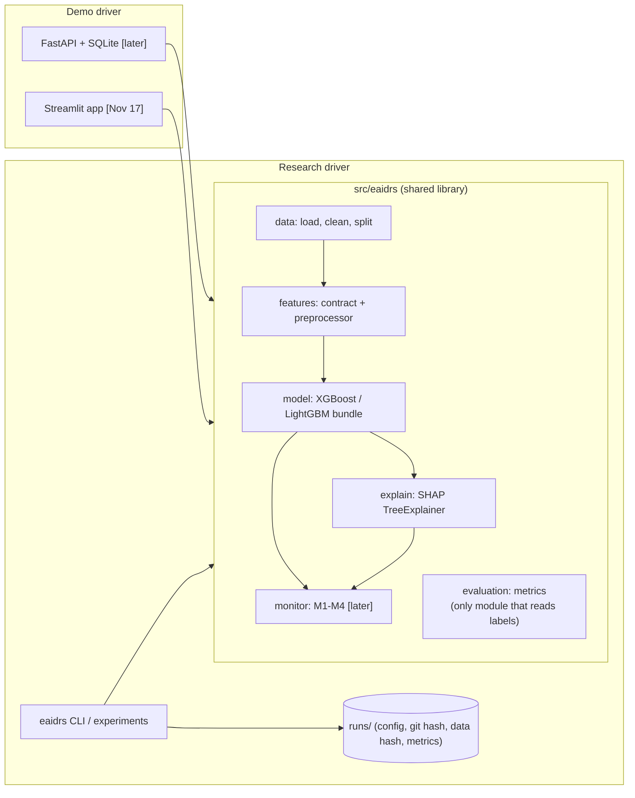
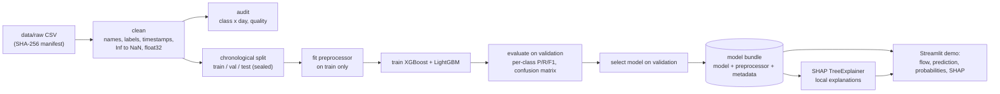
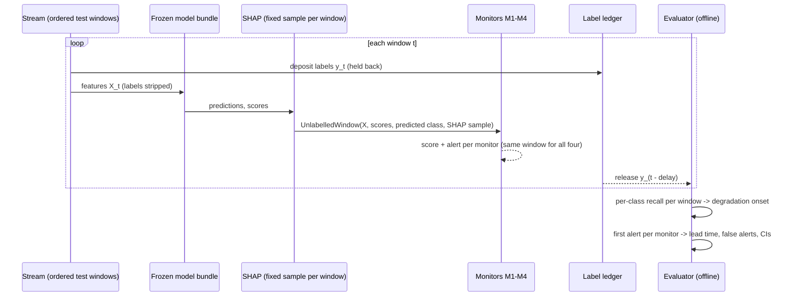

# EA-IDRS Architecture

Status legend: **[built]** implemented and tested · **[Nov 17]** planned for the minor
evaluation · **[later]** Phase 3+ (Dec 2026 onwards).

## 1. One library, two drivers

The research experiments and the demo application are two thin drivers of **one** Python
library, `src/eaidrs/`. Training, the Streamlit demo and (later) the API all call the same
preprocessing, model and SHAP code. This avoids training-serving skew, which would be an
ironic bug in a drift-monitoring project.



## 2. Minor-evaluation pipeline (what runs by Nov 17)



| Stage | Module | Status |
|---|---|---|
| Checksum manifest | `eaidrs.data.manifest` | [built] in PR 2 |
| Load + clean raw CSVs | `eaidrs.data.loading`, `eaidrs.data.cleaning` | [built] on fixtures; real-data verification Nov 8 |
| Class-by-day audit, quality report | `eaidrs.data.audit` | [built] on fixtures; real run Nov 9 |
| Chronological split (two strategies) | `eaidrs.data.splits` | [built] on fixtures; strategy decision Nov 9–10 |
| Run tracking (config, git, data hash, env) | `eaidrs.tracking.run` | [built] |
| Feature contract + preprocessor | `eaidrs.features` | [Nov 17] |
| XGBoost / LightGBM baselines, bundle | `eaidrs.model` | [Nov 17] |
| Validation metrics | `eaidrs.evaluation.classification` | [Nov 17] |
| SHAP local explanations | `eaidrs.explain` | [Nov 17] |
| Streamlit prototype | `apps/dashboard/app.py` | [Nov 17] |
| M1–M4, replay, label ledger, lead-time evaluator | `eaidrs.monitor`, `eaidrs.replay`, `eaidrs.evaluation` | [later] |
| FastAPI, SQLite, Docker, response agent | `apps/api`, `infra/` | [later] |

## 3. Target research architecture (Phase 3–5)



- **M1** feature drift (PSI / KS on selected features)
- **M2** prediction-score and predicted-class-mix drift
- **M3** = M1 + M2 (combined baseline)
- **M4** = M3 + class-conditional SHAP attribution drift, grouped by **predicted** class

Monitors receive an `UnlabelledWindow` type that has no label field. An import-linter contract
will forbid the live path (`monitor`, `explain`, `model`, `replay`) from importing
`evaluation`. See ADR-0004 and `docs/research-roadmap.md`.

## 4. Repository layout

```
ea-idrs/
├── src/eaidrs/          shared library (package `eaidrs`)
│   ├── core/            paths, config models (pydantic)
│   ├── data/            manifest, loading, cleaning, splits, audit
│   ├── tracking/        run folders: config + git hash + data hash + environment
│   └── cli.py           `uv run eaidrs <command>`
├── configs/             data + split configs (YAML, validated by pydantic)
├── tests/               unit + integration tests on synthetic fixtures
├── docs/                architecture, ADRs, cards, logs, minor-evaluation plan
├── data/                gitignored except README.md and MANIFEST.sha256
├── runs/, artifacts/    gitignored outputs
└── frontend/ backend/ ml-service/   legacy scaffold, pending removal decision (ADR-0002)
```

## 5. Deployment (later)

Phase 3+ adds FastAPI (`apps/api`), SQLite (WAL) logging, Docker Compose and an isolated
simulation network that replays **public dataset flows only**, with analyst-triggered blocking.
None of this is needed for Nov 17 and none is claimed as built.
