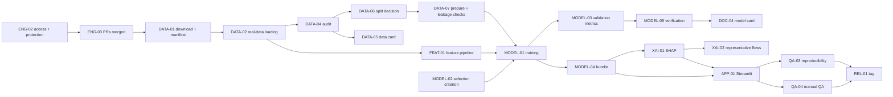

# Minor-Evaluation Delivery Plan (7–16 Nov 2026, presentation 17 Nov)

Owner: Ankit Raj (delivery coordination) · Last updated: 2026-11-06
Detailed per-task acceptance criteria and status: [`checklist.md`](checklist.md).
Evidence for each task: [`evidence-register.md`](evidence-register.md).

## 1. Goal in one sentence

On 17 Nov, show a **real, reproducible** chronological CIC-IDS2017 baseline (XGBoost +
LightGBM, validation metrics per class), real SHAP explanations, and a one-page Streamlit demo,
plus a credible plan for M1–M4 and the delayed-label study. Nothing on a slide may come from
anything other than a recorded run.

## 2. Team and assumed capacity

| Member | Role this sprint | Assumed capacity (confirm at kickoff) |
|---|---|---|
| **Akshat Gupta (AG)** | Technical lead: data loading on real files, features, models, bundle, SHAP, Streamlit | ~4.5 h/day → **~44 h** |
| **Ankit Raj (AR)** | Research, quality and integration lead: audit, split validity, leakage, evaluation metrics, verification, tests, coordination, presentation | ~4.5 h/day → **~44 h** |
| **Aamish Hussain (AH)** | Documentation and QA support: dataset docs, literature matrix, cards, diagrams, manual QA, evidence, formatting | ~3 h/day → **~28 h** |

Calendar: 7, 8, 14, 15 Nov are weekend days (more hours). 9–13 and 16 Nov have classes.
Jatin Garg (listed in the PDF) has no tasks this sprint, per the team's decision.

**Load check.** Planned P0 work is ≈ AG 46 h, AR 47 h, AH 29 h, which is ~100% of the assumed
capacity. **There is almost no slack.** Akshat's lane is the critical path. P1 items start only
when every P0 item on that day is done. If capacity is lower than assumed, cut in this order:
P1 items → MODEL-06 → Streamlit polish (keep the core flow) → second representative flow set.

### Specialist roles nobody on the team is hired for

| Missing specialist | Absorbed by | What it costs this sprint |
|---|---|---|
| Project manager | AR (daily check-in, board, guide communication) | ~0.5 h/day |
| QA engineer | AR (automated tests, regression), AH (manual demo QA) | QA-01, QA-03, QA-04 ≈ 10 h |
| DevOps / CI | AR (CI workflow), AG (repo admin, branch protection) | ≈ 5 h, mostly done 6 Nov |
| Security | AR (secrets, gitignore, public-repo exposure review) | ≈ 1 h; repo is **public** today, see R9 |
| Data engineer | AG (real-data loading), AR (audit) | inside DATA-01..07 |
| Statistician | AR, cross-checked with the guide | not needed until Phase 4 (bootstrap CIs) |
| Technical writer | AH (formatting, structure), each owner writes content | inside DOC-* tasks |

## 3. Ideal vs minimum vs realistic

| Area | Ideal (best practice) | Minimum viable for 17 Nov | Realistic with this team |
|---|---|---|---|
| Data | Original + corrected CIC-IDS2017 compared, DVC remote | One version, manifest, audit, data card | Minimum (corrected version deferred) |
| Split | Decided with guide before any training | Both strategies audited, one chosen and documented | Minimum; guide confirmation may arrive after 17 Nov, then the choice is labelled "proposed" on the slides |
| Models | Tuned XGBoost + LightGBM, ≥3 seeds | Both baselines with fixed config, one seed, validation metrics | Minimum, plus a second seed if time allows (P1) |
| Explainability | Local + global SHAP, class-conditional reference fingerprints | Local SHAP for 2–3 real flows | Minimum + global mean-abs SHAP plot |
| Demo | API + dashboard + DB | Single Streamlit page on the real bundle | Minimum |
| Quality | Pre-commit, ≥80% coverage on research modules, CI required on protected branch | CI with lint, types, tests on fixtures | Minimum + coverage report |
| Monitoring | M1–M4 working | Design only | Design only; optional preliminary M1 plot (P2) |

## 4. Day-by-day schedule

Task IDs link to [`checklist.md`](checklist.md). Hours are estimates including testing and review.

| Date | Milestone | Akshat (AG) | Ankit (AR) | Aamish (AH) | Exit condition |
|---|---|---|---|---|---|
| **Fri 6 Nov** (prep) | Audit + bootstrap | — | ENG-01 repo audit + tooling + docs; DATA-00 data-pipeline foundation on fixtures | — | Both branches ready locally, all checks green |
| **Sat 7 Nov** | Repository and access | ENG-02 grant write access + branch protection (1 h); review PR 1 and PR 2 (3 h); ENG-05 setup | ENG-04 milestone + issues (1.5 h); ENG-03 push + open PRs (1 h); RES-01 guide meeting request (1 h); ENG-05 setup | ENG-05 setup (0.5 h); DOC-01 documentation inventory (2 h) | PR 1 merged; everyone's `uv run pytest` passes |
| **Sun 8 Nov** | Data acquisition | DATA-01 download + manifest (2 h); DATA-02 run loader on real files, fix mismatches (3 h) | DATA-01 verify manifest on 2nd machine (1 h); review DATA-02 | DATA-03 dataset source documentation (2 h) | Manifest committed; `eaidrs audit` runs end-to-end on real data |
| **Mon 9 Nov** | Dataset audit | FEAT-01 feature contract + preprocessor (start, 2 h) | DATA-04 audit both split strategies (4 h) | DOC-02 literature matrix + DOI checks (3 h) | Audit run folder exists; class-by-day table reviewed |
| **Tue 10 Nov** | Temporal pipeline | FEAT-01 finish (3 h) | DATA-05 data card (3 h); DATA-06 split proposal to guide (3 h); DATA-07 prepare + leakage checks (2 h) | DATA-05 formatting (1 h); TEST-01 fixture support (2 h) | Processed train/val written; split invariants pass on real data |
| **Wed 11 Nov** | Baseline training | MODEL-01 XGBoost + LightGBM training (8 h, may spill into Thu) | MODEL-02 pre-declare selection criterion + config review (2 h); MODEL-03 evaluation module (start, 2 h) | DOC-03 evidence register upkeep (1 h); DOC-08 architecture diagrams (2 h) | Two training runs recorded |
| **Thu 12 Nov** | Evaluation + bundle | MODEL-04 bundle save/load + predict (4 h) | MODEL-03 finish (2 h); MODEL-05 verify metrics independently (2 h) | DOC-04 model card draft (3 h) | Validation metrics for both models; model chosen on validation |
| **Fri 13 Nov** | Explainability | XAI-01 SHAP explainer + tests (5 h) | XAI-02 representative flows: selection rule + interpretation review (3 h) | DOC-05 SHAP evidence capture (1 h) | SHAP outputs for 2–3 real validation flows in a run folder |
| **Sat 14 Nov** | Prototype | APP-01 Streamlit app (7 h) | QA-01 end-to-end fixture test + Streamlit AppTest (4 h) | DOC-06 demo runbook / user guide (2 h) | App runs on the real bundle with one command |
| **Sun 15 Nov** | QA + docs | QA-02 bug fixing (4 h) | QA-03 fresh-clone reproducibility check (4 h); RES-02 research roadmap (2 h) | QA-04 manual demo test (2 h); DOC-07 README update (2 h) | All P0 bugs closed; reproducibility confirmed on a 2nd machine |
| **Mon 16 Nov** | Release | REL-01 tag `v0.1-minor-eval` (0.5 h); REL-03 rehearsals (2 h) | REL-01 final verification (1 h); REL-02 slides content (3 h); REL-03 rehearsals (2 h) | REL-02 slide formatting (3 h); REL-03 backup recording (2 h); REL-04 final checklist + backups (1 h) | Feature freeze 12:00; tag created; 2 rehearsals done; video backup saved |
| **Tue 17 Nov** | Presentation | Demo | Presentation lead | Evidence + backup laptop | — |

### Parallel tracks and dependencies

Independent of the critical path (can run any day): DOC-01, DOC-02, DOC-08, RES-01, RES-02,
QA-01 (fixtures only), TEST-01.

**Critical path:** ENG-02 → DATA-01 → DATA-02 → DATA-04/06/07 → MODEL-01 → MODEL-04 → XAI-01 →
APP-01 → QA → REL-01. A one-day slip anywhere on it removes the remaining buffer.

## 5. GitHub workflow

**Current blocker:** Ankit's GitHub account has **read-only** access to
`guptaksht10/ea-idrs`, `master` is unprotected, and the repository is **public**. Akshat (owner)
must do ENG-02 first:

1. Settings → Collaborators → add `dev-rajankit` and Aamish's account with **Write** role.
2. Settings → General → Pull Requests: allow **squash merging** only; enable
   "Automatically delete head branches".
3. Settings → Branches → add a rule (or ruleset) for `master`: require a pull request,
   **1 approval**, dismiss stale approvals, require the status check
   **"Lint, types, tests (Python library)"**, block force pushes and deletion.
4. Decide on visibility (see risk R9): the blueprint recommends **private** until results are final.

**Issues.** Create the milestone "Minor evaluation (17 Nov)" and one issue per task in
[`checklist.md`](checklist.md), **before** opening any PR. GitHub issues and PRs share one
number sequence. Create `ENG-01` first (#1) and `DATA-00` second (#2) so the existing branch
names stay correct. Labels: `P0`, `P1`, `P2`, `data`, `model`, `explain`, `app`, `docs`,
`qa`, `research`.

**Branches.** `<type>/<issue-number>-<short-description>`, types `feat | fix | exp | docs | chore |
refactor | test`, at most 3–4 days old. Already created locally:

| Branch | Base | Content |
|---|---|---|
| `chore/1-repo-bootstrap` | `master` | Tooling, lockfile, CI, templates, CODEOWNERS, CONTRIBUTING, README, AGENTS.md, docs and plan |
| `feat/2-cicids-data-pipeline` | `chore/1-repo-bootstrap` (stacked) | Manifest, loading, cleaning, chronological splits, audit, run tracking, CLI, fixture tests |

**Commits.** Conventional Commits (`feat(data): ...`, `test(data): ...`, `docs(research): ...`).

**PRs.** Template in `.github/PULL_REQUEST_TEMPLATE.md`. Draft first, ready when CI is green.
One approval from someone other than the author (AG ↔ AR review each other; AH's PRs are
reviewed by AR). Squash merge. Target < 400 changed lines excluding lockfile.

**Review pairs:** ML code by AG → reviewed by AR (methodology, leakage). Research/QA code by
AR → reviewed by AG (implementation). Docs by AH → reviewed by AR.

**Tag:** `v0.1-minor-eval` on `master` after REL-01 verification. Never force-push.

## 6. Technical implementation order

| Order | Task | Files | Tests that must pass |
|---|---|---|---|
| 1 | ENG-01 bootstrap | `pyproject.toml`, `uv.lock`, `.github/`, docs | smoke import test, ruff, mypy |
| 2 | DATA-00 data foundation | `src/eaidrs/{core,data,tracking}`, `cli.py`, `configs/` | cleaning (NaN/Inf, labels, timestamps), split no-overlap + ordering, manifest tamper detection, audit counts, run folder contents |
| 3 | DATA-01/02 real data | `data/MANIFEST.sha256`, `configs/data/cicids2017.yaml` fixes | manifest verify; loader on all 8 files without schema errors |
| 4 | DATA-04..07 audit + split | run folders, `docs/data-card.md`, ADR-0008 | split invariants on real data (built into `eaidrs prepare`) |
| 5 | FEAT-01 feature pipeline | `src/eaidrs/features/` | feature order stable; identifiers excluded; constant-column removal fitted on train only; save/load round-trip |
| 6 | MODEL-01..05 | `src/eaidrs/model/`, `src/eaidrs/evaluation/classification.py`, `configs/model/*.yaml` | predictions have valid classes; probability rows sum to 1; metrics match sklearn on a fixture; bundle round-trip gives identical predictions |
| 7 | XAI-01/02 | `src/eaidrs/explain/` | SHAP additivity (base + Σ SHAP = raw margin) on a fixture model; output shape per class |
| 8 | APP-01 | `apps/dashboard/app.py` | Streamlit `AppTest` launches and renders on a fixture bundle |
| 9 | QA-01 | `tests/integration/` | fixture end-to-end: prepare → train → bundle → explain |

When `eaidrs.model`, `eaidrs.explain` and `eaidrs.evaluation` exist, add import-linter contracts:
`model` and `explain` must not import `evaluation` (ADR-0004).

## 7. Risks and contingencies

| # | Risk | Likelihood | Impact | Fallback | Owner |
|---|---|---|---|---|---|
| R1 | Repo access / branch protection not set up on 7 Nov | Medium | High (no PRs) | Ankit forks and opens PRs from the fork; Akshat merges | AG |
| R2 | Dataset download slow or blocked (form, mirror, size) | Medium | High | Start the download on 7 Nov; use a verified mirror and record its source + hashes; second machine downloads in parallel | AG |
| R3 | Real files differ from the configured schema (column names, timestamp format, encoding) | High | Medium | Config-driven loader; DATA-02 reserves 3 h to fix; the audit reports every mismatch | AG |
| R4 | Day-based split leaves most attack classes out of training | High (expected) | High | `grouped_time` strategy already implemented; decide on audit evidence (ADR-0008) | AR |
| R5 | Guide unavailable to confirm D1/D2/split before 17 Nov | Medium | Medium | Present them as "proposed, pending guide confirmation" with the evidence; do not claim approval | AR |
| R6 | Training too slow / RAM pressure on full data | Low–Medium | Medium | float32, `hist` tree method, fewer rounds for the baseline; run on the 16 GB machine | AG |
| R7 | SHAP on multi-class model slow | Medium | Low | Explain only the demo flows and a fixed sample; cache results in the run folder | AG |
| R8 | Akshat overloaded (critical path at ~100%) | High | High | AR owns evaluation metrics, representative-flow selection and integration tests; drop P1 items; Streamlit kept to one page | AR |
| R9 | Repository is public while research is in progress | — | Medium | Blueprint recommends private until results are final. Team decides in ENG-02. Never commit data, private docs or secrets either way | AG + AR |
| R10 | Live demo fails on the day | Medium | High | Demo runs offline from local bundle; rehearsed twice; recorded video + screenshots + run folders as backup | AH |
| R11 | Metrics look "too good" (shortcut features, leakage) | Medium | High | Identifier columns excluded; leakage checklist (DATA-07); MODEL-05 independent verification; report validation only | AR |
| R12 | Test split accidentally used | Low | High | Test split stored under `sealed/`; loader refuses it by default; PR checklist item | AR |

## 8. After 17 Nov: roadmap to the final evaluation

Assumes the major evaluation in **Mar/Apr 2027** (PDF). If the guide confirms Apr/May, the
extra month becomes buffer, not new scope. Confirm in RES-01.

| Phase (PDF) | Dates | Deliverables | Lead |
|---|---|---|---|
| 3. Monitors | 18 Nov – 20 Dec 2026 | Window stream; M1 (PSI/KS), M2 (score + class mix), M3; M4 class-conditional SHAP (one pre-registered distance); `UnlabelledWindow` + firewall contract; unit tests. Exams in Dec at reduced capacity | AR (monitors), AG (SHAP reference) |
| 4. Core experiments | 21 Dec 2026 – 31 Jan 2027 | Shift injectors (scale, class-conditional, concept proxy, no-degradation control), label ledger, evaluator (onset, lead time, false alerts, coverage), validation calibration to a common false-alarm budget; Experiments B, C, D, E, then **F (M3 vs M4)** | AR + AG |
| 5. Analysis and system | Feb 2027 | Experiment G (window size, SHAP sample fraction, seeds, plus RQ3 axes), runtime (RQ4), literature-gap re-check with full texts; FastAPI + SQLite; dashboard drift/alert pages | AR (analysis), AG (API/dashboard), AH (docs/figures) |
| 6. Finalisation | Mar – Apr 2027 | Results freeze tag `results-v1`, report, Docker demo with isolated sim network (analyst-triggered blocking only), rehearsals, `v1.0-major-eval` | All |

Details of the research design: [`../research-roadmap.md`](../research-roadmap.md).
